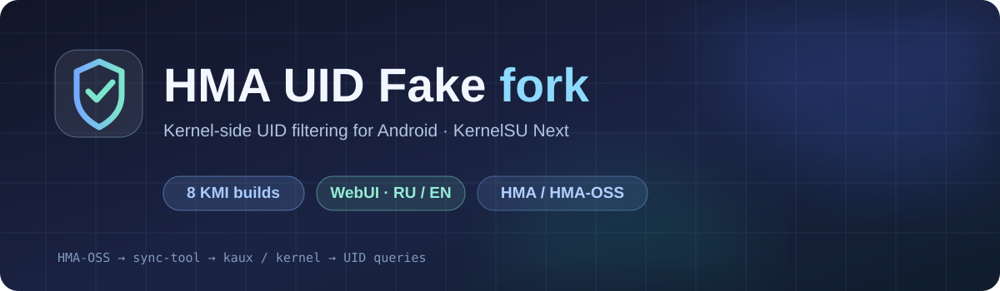

# HMA UIDFAKE — патчи для ядра

**Нативная интеграция в Image: без .ko, LKM-загрузчика и отдельного модуля UIDFAKE.**

**Русский** · [English](README_EN.md)

## Что находится в этой ветке

Комплект для разработчиков ядер: нативный движок UIDFAKE, полные патчи, проверяемый интегратор, регрессионные тесты и автоматическая синхронизация правил HMA/HMA-OSS.

Ядровой компонент компилируется с **CONFIG_HMA_UIDFAKE_BUILTIN=y**. Конфигурацию HMA читает привилегированный userspace-процесс: ядро не должно самостоятельно разбирать зашифрованные файлы приложения. Готовый Android sync-tool можно получить с проверкой SHA-256 либо собрать из включённых исходников.

**Это не установочный ZIP модуля и не готовое ядро для любого телефона.** Обычные LKM-релизы остаются в [main](https://github.com/Mobilelegends74/hma-uidfake/tree/main). Ветка не создаёт релизы, не меняет Latest и содержит только CI с правами чтения.

## С чего начать

| Задача | Файл |
|---|---|
| Полная инструкция на русском | [Интеграция, сборка и упаковка](docs/native/INTEGRATION_RU.md) |
| English instructions | [Integration guide](docs/native/INTEGRATION_EN.md) |
| Готовые самостоятельные патчи | [Базы и выбор патча](patches/README.md) |
| Подключение к изменённому ядру | [Проверяемый интегратор](scripts/uidfake-native-integrate.py) |
| Нативные Kconfig/Kbuild и исходники | [uidfake/kernel](uidfake/kernel) |
| Устройство, ограничения, совместимость | [Architecture](docs/native/ARCHITECTURE.md) |
| Синхронизация HMA, диагностика и откат | [Troubleshooting](docs/native/TROUBLESHOOTING.md) |
| CI, SHA-256 и проверка патчей | [Проверки комплекта](.github/workflows/native-patches.yml) |

## Поддерживаемые версии

Все восемь целей модуля: **android12-5.10, android13-5.10, android13-5.15,
android14-5.15, android14-6.1, android15-6.6, android16-6.12, android17-6.18**.
Для каждой есть полный патч и отдельная CI-компиляция встроенного компонента
с затронутыми файлами ядра. [Матрица и границы проверки](docs/native/COMPATIBILITY.md).

## Проверенные интеграции

- [OnePlus 13R, Android 14 / Linux 6.1.118](https://github.com/Mobilelegends74/OnePlus_KernelSU_SUSFS/releases/tag/op13r-6.1.118-2026-10-19-build90-1-uidfake).
- [GKI Android 14 / Linux 6.1.145](https://github.com/Mobilelegends74/GKI_KernelSU_SUSFS/releases/tag/gki-android14-6.1.145-2026-10-19-build53-1-uidfake).

Обе интеграции собраны; пользователь подтвердил работу на своём устройстве. Это не гарантия совместимости всех прошивок, всех хуков и всех типов процессов. Полная сборка иных версий Linux/Android и других архитектур здесь не заявляется.

Перед прошивкой нужны совместимая база ядра, резервная копия boot и проверенный способ восстановления. Не устанавливайте отдельный UIDFAKE LKM поверх встроенного компонента. Требования самого HMA/HMA-OSS к внедрению сохраняются.

Лицензия GPL-2.0; происхождение исходников и companion-бинарника — [NOTICE](uidfake/NOTICE).
